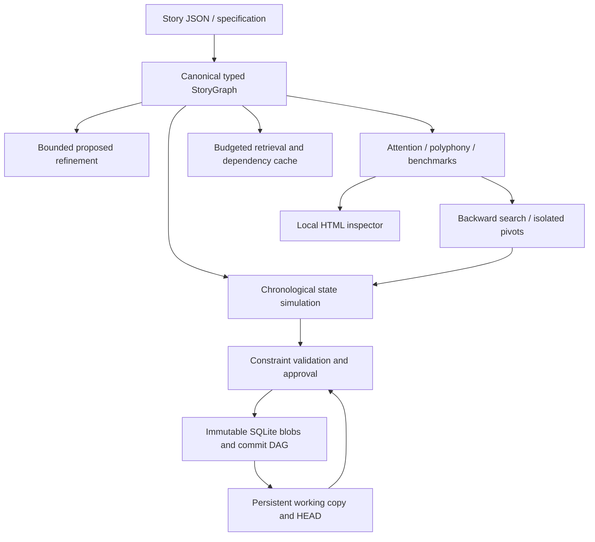

# Architecture

`core/schema.py` defines immutable-by-convention Pydantic records. `core/graph.py` projects them into a NetworkX MultiDiGraph and returns copies through public accessors. `core/state_machine.py` applies atomic transitions on flat namespaced state keys (`world.*`, `character.*`, `resource.*`) with independent knowledge/belief ledgers. Numeric diegetic `time`, presentation `order`, and `revelation_order` are independent. Testimony belongs in HYPOTHETICAL nodes; it does not alter actual state. Time travel requires an explicit timeline/state model supplied by an extension; it is not silently inferred.

SQLite story blobs are content-addressed JSON. Separate immutable commits record
ordered parent IDs, message, author and creation metadata, so identical story
content can occur in distinct commits. Mutable named branches, immutable tag
names, symbolic/detached HEAD and a persistent whole-story working copy provide
Git-inspired local history. An immutable reflog records HEAD/ref and merge transitions.
Triggers protect append-only records. Legacy snapshot/history tables remain
untouched during additive, idempotent migration.

`core/versioning.py` owns the public store, references and loaded-state
concurrency checks. `core/vcs_storage.py` implements additive schema migration;
`core/vcs_operations.py` owns atomic commit/merge/revert lifecycle transitions. `core/merge.py` performs pure stable-ID three-way merging: mappings merge
recursively, ordered lists are atomic, missing keys differ from null, and derived
version counters do not produce artificial conflicts. Merge bases follow the
full commit DAG; unsupported ambiguous bases fail explicitly. Conflicts persist
as pending work without moving HEAD. Explicit path choices stage a resolution,
and a later commit records the merge parents. A revert uses the same mechanism
with an inverse commit delta, preserving unrelated later changes.

Nodes and edges carry evidence, confidence, provenance and version. Isolated
optimization branches deep-copy the same canonical document; saved story
branches additionally preserve ancestry in the database. Model proposals remain
PROPOSED and cannot execute during canonical simulation. Mandatory design
constraints and invariants are separate: the former constrain refinement, the
latter inspect simulation state. Canon protections and new state regressions
are checked before merge/revert commits.

Analysis consumes `StoryGraph`: `.nodes` and `.edges` are dictionaries keyed by ID, `.document` is a defensive-copy Project, `.get(id)`, `.incoming(id)`, `.outgoing(id)`, `.clone()`, `.update_node(id, changes, authorized=False)`, `.add_node(Node)`, `.add_edge(Edge)`, `.validate() -> list[Finding]`. Node freeform narrative annotations live in `attributes`; actual state semantics live in `transition: Transition | None`. No analytic projection is a second canon.

Technology: Pydantic validates input; NetworkX supplies typed multigraph traversal; SQLite avoids a server; argparse keeps CLI startup/dependencies small; HTML export is self-contained. Tradeoffs include coarse flat state semantics, in-memory graph copies and explicit schema migration rather than distributed storage. Providers are bounded structured-output interfaces; no vendor SDK is required for offline operations.
