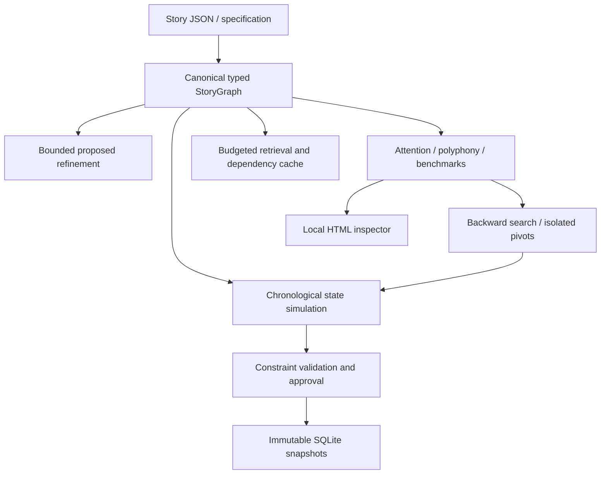

# Architecture

`core/schema.py` defines immutable-by-convention Pydantic records. `core/graph.py` projects them into a NetworkX MultiDiGraph and returns copies through public accessors. `core/state_machine.py` applies atomic transitions on flat namespaced state keys (`world.*`, `character.*`, `resource.*`) with independent knowledge/belief ledgers. Numeric diegetic `time`, presentation `order`, and `revelation_order` are independent. Testimony belongs in HYPOTHETICAL nodes; it does not alter actual state. Time travel requires an explicit timeline/state model supplied by an extension; it is not silently inferred.

SQLite snapshots are content-addressed JSON; triggers prevent UPDATE/DELETE of history. Nodes and edges carry evidence, confidence, provenance and version. Branches deep-copy the same canonical document. Model proposals remain PROPOSED and cannot execute during canonical simulation. Mandatory design constraints and invariants are separate: the former constrain refinement, the latter inspect simulation state.

Analysis consumes `StoryGraph`: `.nodes` and `.edges` are dictionaries keyed by ID, `.document` is a defensive-copy Project, `.get(id)`, `.incoming(id)`, `.outgoing(id)`, `.clone()`, `.update_node(id, changes, authorized=False)`, `.add_node(Node)`, `.add_edge(Edge)`, `.validate() -> list[Finding]`. Node freeform narrative annotations live in `attributes`; actual state semantics live in `transition: Transition | None`. No analytic projection is a second canon.

Technology: Pydantic validates input; NetworkX supplies typed multigraph traversal; SQLite avoids a server; argparse keeps CLI startup/dependencies small; HTML export is self-contained. Tradeoffs include coarse flat state semantics, in-memory graph copies and explicit schema migration rather than distributed storage. Providers are bounded structured-output interfaces; no vendor SDK is required for offline operations.
