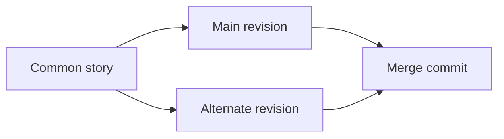

# Story version control

NARRATIVE stores a story's working copy and history in its SQLite database. A
commit records a complete structured story plus its parent commit IDs. Branches
name alternate lines of development; tags name fixed revisions. These operations
work offline and do not invoke Git or track arbitrary files.



## Save, inspect and commit

```bash
narrative --db novel.db init --example
narrative --db novel.db status
narrative --db novel.db export --format json --output draft.json
```

Edit `draft.json` in a text editor, then save it as the working copy:

```bash
narrative --db novel.db save draft.json
narrative --db novel.db diff
narrative --db novel.db compile
narrative --db novel.db commit -m "Strengthen the witness's motivation"
```

`save` validates and persists the whole document without creating a commit. The
working copy survives process restarts. `status` reports the branch, commit at
HEAD, attached/detached state, dirty flag, working revision, changes and any
pending merge/revert. `commit` records the saved work and advances HEAD. Existing
`init`, `ingest`, `refine` and approved `pivot` commands keep their whole-story
auto-commit behavior.

Use `commit -m "Describe the decision" --author "Your name"` to record an explicit author.

`commit` requires a nonblank message and rejects a clean working copy with
`Nothing to commit`; failed commits leave the saved draft available. A fully
resolved pending merge can still create its required two-parent commit when its
chosen story content matches the current side. The compatibility Python API
`commit(graph, ...)` can record repeated content as distinct authoring events.

Locked changes and PROPOSED→CANON promotions require explicit authorization for
the affected node IDs. Repeat `--authorize-locked NODE_ID` on `save` and on the
final `commit` when needed. Merge and revert accept the same flag. Authorization
is scoped to the requested operation; an unlocked node is not general permission
to overwrite another locked fact.

Ordinary authoring can preserve state-defective stories, so saving or committing
is not proof of successful simulation. `compile` reports chronological failures,
and `audit` also runs full structural and evaluation diagnostics. Merge and revert
reject newly introduced simulation failures relative to current HEAD.

## Branches, tags and HEAD

```bash
narrative --db novel.db branch
narrative --db novel.db branch alternate-ending
narrative --db novel.db branch earlier-experiment --start HEAD~1
narrative --db novel.db switch alternate-ending
narrative --db novel.db tag review-candidate
narrative --db novel.db tag
narrative --db novel.db checkout review-candidate
narrative --db novel.db status
narrative --db novel.db switch main
```

Creating a branch does not switch to it. `switch` requires an existing branch and
attaches HEAD to that branch. `checkout` of a branch also attaches; checkout of a
tag or commit detaches HEAD. Commits made while detached remain accessible by ID
and log, but do not advance a named branch. Create a branch from that commit to
give the work a durable name. Existing tag names cannot be overwritten.

After returning from a detached experiment, find it with `log --all`, then name
and reopen that exact commit:

```bash
narrative --db novel.db branch recovered-experiment --start COMMIT_ID
narrative --db novel.db switch recovered-experiment
```

Checkout refuses to overwrite dirty work. Save it as a commit first, or explicitly
discard the uncommitted document with:

```bash
narrative --db novel.db checkout main --discard-changes
```

There is no destructive branch reset or deletion command in this release.

## Inspect revisions

```bash
narrative --db novel.db log
narrative --db novel.db log alternate-ending --limit 20
narrative --db novel.db log --all
narrative --db novel.db show HEAD
narrative --db novel.db reflog --limit 20
narrative --db novel.db diff
narrative --db novel.db diff review-candidate
narrative --db novel.db diff main alternate-ending
```

`log` follows ancestry from a revision; `--all` includes all stored commits.
Records expose ordered parents, including two parents for a true merge.
`history` remains a compatibility view of all commits, oldest first. `show`
includes immutable commit metadata and the complete story document.

Diff accepts zero references for HEAD→working, one for revision→working, or two
for revision→revision. It reports added, removed and changed node/edge IDs plus
changed project fields. Revision syntax includes branch names, tag names, full
commit IDs, unique prefixes of at least seven characters, `HEAD~N` for N
first-parent steps, and `HEAD^N` for the Nth parent. Qualified
`refs/heads/NAME` and `refs/tags/NAME` distinguish matching names.

## Merge alternate stories

```bash
narrative --db novel.db switch main
narrative --db novel.db merge alternate-ending -m "Combine ending revisions"
```

The merge uses the common ancestor in the commit DAG. If the target is already
an ancestor, the result is `up_to_date`. A descendant can produce `fast_forward`.
A divergent successful merge creates a commit with both parents. Dirty working
changes and pending operations must be handled before another merge.

Nodes and edges merge by their stable IDs. Independent mapping-field edits can
combine automatically. Ordered lists are atomic, so competing edits to the same
list require a choice. Deleted fields differ from fields containing JSON null.
Record version counters are recomputed instead of causing artificial conflicts.

Conflicts return a nonzero exit code and JSON records containing each path,
base/ours/theirs values, existence flags, and reason. HEAD stays unchanged. Use
the paths from that response exactly; a path can select one field without
discarding unrelated edits:

```bash
narrative --db novel.db merge --resolve '/nodes/CLIMAX/label=ours'
narrative --db novel.db merge --resolve '/nodes/CLIMAX/attributes/motivation=theirs'
narrative --db novel.db diff
narrative --db novel.db commit -m "Resolve the climax conflict"
```

Each `--resolve` accepts `ours`, `theirs`, or `base`. Repeat the option to choose
several paths together. Partial choices retain the remaining conflicts and
return nonzero status. Full resolution stages the merged working copy; it does
not commit until the explicit `commit`. Canon protections and regression
validation still apply. Cancel a pending merge or revert with:

```bash
narrative --db novel.db merge --abort
```

Abort restores the exact pre-operation working state. A validation failure is
reported as `invalid` without staging the candidate: HEAD, refs and the working
copy remain exactly as they were before the operation. Correct the source story
on a branch and retry the merge or revert. There is no pending invalid candidate
to finish with `commit` or cancel with `merge --abort`.

## Revert a change

```bash
narrative --db novel.db revert HEAD~1 -m "Undo the earlier rule change"
```

Revert applies the inverse delta of the selected commit against current HEAD.
Unrelated later changes remain. A clean result becomes a new commit; history is
not rewritten. Conflicting reverts use the same `merge --resolve`, `commit`, and
`merge --abort` workflow. Root commits have no previous story to restore. Reverting a root or merge
commit is unsupported; merge reverts also require an explicit mainline parent.

## Persistence and limits

Immutable content blobs are distinct from commit identities. Two commits may
contain identical story content yet have different ancestry, messages or
creation metadata. Opening an older database adds version-control records
without altering its snapshots or history. Duplicate legacy content remains
represented by distinct commits. Legacy blob hashes can still load and diff
content; ambiguous aliases cannot determine ancestry.

The working story has a `working:<digest>` version when dirty. This prevents
version-scoped evaluation ratings from being reused as though the draft were
the original commit. Use `status().head` for ancestry, not the draft's version.

Transactions compare the writer's loaded HEAD and working revision; a stale
writer fails without creating an orphan commit. Append-only records protect
application history, not a database owner's ability to tamper with files.
Whole-document snapshots and copies target small local projects. There is no
remote synchronization, partial staging, semantic prose merge or collaborative
editing service. Unrelated histories and ambiguous multiple merge bases fail
explicitly. A structurally mergeable story can still be artistically incoherent;
the version-control layer does not judge reader experience.

## Recover earlier HEAD positions

`reflog --limit 20` lists append-only commit, checkout, branch/tag and merge
operations with old/new commit IDs. To keep a detached experiment, create a
branch from the selected commit ID, then switch to that branch. The log records
HEAD/ref and merge transitions; it is not a recoverable history of every saved
uncommitted draft. No `HEAD@{N}` selector is provided in this release.

Exact full commit IDs take precedence over ref names. For a branch deliberately
named like a hash, use its qualified `refs/heads/NAME`. Writing from a stale
commit or content alias cannot overwrite a newer saved draft; reload the working
copy before continuing. `status` and working loads establish the optimistic
revision checked by the next mutation.

Conflicts can require a graph-wide edit beyond selecting the reported paths
(for example, deleting a scene that another branch links to). If the selected
result is structurally invalid, it remains unstaged. Abort, make the needed
structural change on a source branch, commit, and merge again.
